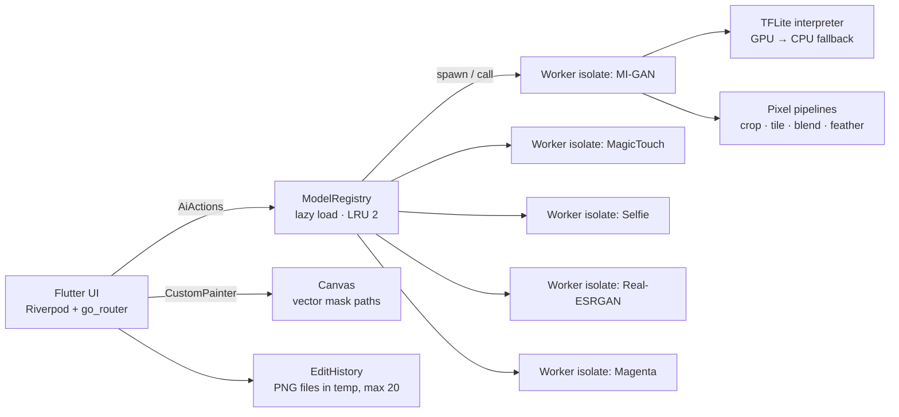

# PixelFix: offline AI photo studio (Flutter + TFLite)

PixelFix edits photos with small neural networks that run **entirely on the phone**: no server, no API keys, no internet permission.

| Feature | What it does | Model |
|---|---|---|
| Magic Eraser | Brush over an object, it disappears | MI-GAN 512 (fp16) |
| Tap-to-Select | Tap an object, it is masked (editable with the brush) | MediaPipe MagicTouch |
| Expand | Extend to 1:1, 4:5, 16:9, 9:16 or custom | MI-GAN (border = hole) |
| Background Studio | Remove / blur / replace the background | MediaPipe Selfie Segmenter |
| AI Upscale 2× / 4× | Sharpen and enlarge | Real-ESRGAN General x4v3 |
| Art Styles | 6 bundled styles or any gallery image, strength slider | Magenta stylization (int8) |
| Smart Combos | Remove person · Old photo fix · Insta fit | chains of the above |

Screenshots: _add after running on your phone_ (`docs/screenshots/`).

## Architecture



* **Isolates:** each model owns a long-lived worker isolate that creates its interpreter and runs *both* inference and pixel loops. Images travel as `TransferableTypedData`. The UI isolate only draws.
* **Delegates:** GPU first, validated by a warm-up run (NaN check), automatic CPU fallback with 4 threads; Auto / GPU / CPU in Settings.
* **Memory:** at most 2 models loaded; photos capped at 3000 px; undo as files.
* **Folders:** `lib/core` (theme, router, pixel utils, widgets) · `lib/ml` (registry, workers, pipelines) · `lib/features/*` (home, editor, compare, export, gallery, settings, onboarding) · `lib/data` (history, projects).

## How each model works (plain words)

* **MI-GAN**: a small generator network. It sees the picture with a hole (mask) and paints plausible content into the hole. For erasing, only a square window around the hole is processed at 512×512 and just the masked pixels are blended back (feathered edge). For Expand, the new border is the hole.
* **MagicTouch**: segmentation network that gets the picture plus a dot where you tapped, and returns the mask of that object.
* **Selfie Segmenter**: 256×256 person/background mask, enlarged and softened.
* **Real-ESRGAN**: ×4 super-resolution on 128 px tiles, overlaps cross-faded.
* **Magenta stylization**: a *predict* network turns a style image into 100 numbers; a *transfer* network repaints your photo with them.

## Build

```bash
flutter pub get
tools/fetch_models.sh        # Windows: powershell -File tools/fetch_models.ps1
flutter build apk --release --split-per-abi
flutter build appbundle
```

> **Windows note:** if the project path contains `&` (for example `tflite&flutter`), Gradle fails. Build through a junction without special characters: `mklink /J C:\pixelfix "<path>\pixelfix"` and run Flutter from `C:\pixelfix`.

Models (≈ 29.4 MiB) are listed with sources, licences and tensor shapes in [`assets/models/MODELS.md`](assets/models/MODELS.md).

## Release sizes

Measured from `flutter build apk --release --split-per-abi` (R8 + resource shrinking on):

| APK | Size |
|---|---|
| arm64-v8a | **54.0 MB** |
| armeabi-v7a | 49.2 MB |
| x86_64 | 56.9 MB |

The 45 MB arm64 target is **not met**: bundled models are 30 MB and the Flutter engine (10.8 MB), Dart code (6 MB) and the TFLite + GPU native libraries (6.7 MB) are fixed overhead. See `DECISIONS.md` #15 for the options (drop MagicTouch: about -6 MB, or an on-demand model pack). `flutter build appbundle` was not run in this environment.

**Verification status:** unit and widget tests pass and the release build works. The app was installed and rendered on an Android emulator, but that emulator was too slow on the build machine to drive the AI tools. The model pipelines have therefore **not been run on a device**: the tensor layouts were checked with the LiteRT interpreter in Python and the pixel logic with fake models in unit tests. Please run each tool once on your phone and fill `BENCHMARKS.md`.

## Tests

`flutter test`: pixel ops, MI-GAN tensor packing, window planning, tiling/blending (seam test), upscale planning, style blending, MagicTouch packing, background compositing, expansion, and widget smoke tests.

## Docs

`DESIGN.md` · `DECISIONS.md` · `BENCHMARKS.md` (blank cells for your phone) · `VIVA_NOTES.md` · `PLAN.md`
